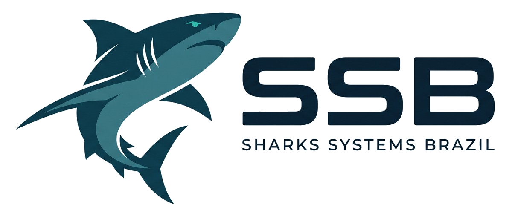

# LeadEvent

Sistema para captação de leads, credenciamento e automação de outreach em eventos. O LeadEvent integra formulários dinâmicos segmentados (Influenciadores e Patrocinadores), submissão opcional de vídeo, painel de triagem de perfis e fila de disparos automatizados com delay seguro anti-spam para WhatsApp e Instagram.

Desenvolvido por **SSB – Sharks Systems Brazil**.

## Stack

- Next.js 16 (App Router)
- React 19 + TypeScript
- Tailwind CSS 4
- shadcn/ui (`components.json`, `src/components/ui`)
- framer-motion (animações dos formulários)

## Como rodar

```bash
npm install
npm run dev
```

Abra [http://localhost:3000](http://localhost:3000).

```bash
npm run build   # build de produção
npm run start   # serve o build
npm run lint    # ESLint
```

## Variáveis de ambiente

O Cloudflare Turnstile é carregado com a chave pública definida em `.env.local`:

```bash
NEXT_PUBLIC_TURNSTILE_SITE_KEY=sua_site_key
```

Sem a variável, o widget não é exibido. Crie um widget Turnstile no painel da Cloudflare para o domínio do site e informe a site key. A verificação completa do token exige uma chamada server-side à API `siteverify` com a secret key, que não faz parte deste frontend.

## Tela de acesso

A página inicial (`/`) exibe a escolha de perfil no lugar do formulário de login:

- **Sou Empresa** → `/empresa`
- **Sou Influencer** → `/influencer`

Arquivos principais:

- `src/app/page.tsx` — composição da página inicial (testemunhos, vídeo e rotas).
- `src/components/ui/sign-in.tsx` — componente shadcn da tela de acesso. Recebe `roles`, `testimonials`, `videoSrc`, `videoPosterSrc` e `onSelectRole`.
- `src/app/empresa/page.tsx` e `src/app/influencer/page.tsx` — rotas dos formulários.
- `src/components/forms/influencer-form.tsx` e `src/components/forms/company-form.tsx` — formulários completos.
- `src/components/forms/video-preview.tsx` — prévia de vídeo (YouTube, Vimeo, link direto e upload).
- `src/lib/form-validation.ts` — máscaras e validações compartilhadas.

As rotas dos botões ficam no array `roles` em `src/components/ui/sign-in.tsx` e podem ser trocadas sem alterar o layout:

```tsx
{
  id: "company",
  label: "Empresa",
  title: "Sou Empresa",
  description:
    "Sua empresa será patrocinadora do evento e a marca será divulgada para todo o público.",
  href: "/empresa",
  badge: "Patrocinador",
}
```

## Formulários

O formulário de influencer usa o layout de duas colunas com prévia do vídeo à direita. No celular, a prévia aparece logo abaixo dos campos de vídeo.

- **Influencer** (`/influencer`): nome, Instagram, telefone, descrição, nicho (com opção “Outro”), link ou upload de vídeo, faixa de seguidores, outras redes sociais (até 5, com seletor de plataforma e atalhos para o perfil), estado/cidade e consentimento.
- **Empresa** (`/empresa`): nome fantasia, CNPJ, e-mail de contato, responsável, Instagram ou site, descrição, formatos de parceria, disponibilidade para reunião e consentimento.

Validações e máscaras rodam apenas no frontend: nome completo, `@` do Instagram, telefone com DDD, CNPJ com dígitos verificadores, e-mail, site e links de vídeo. As cidades são carregadas da API de localidades do IBGE ao selecionar o estado, com opção de digitar a cidade manualmente. Vídeos enviados são validados por tipo, tamanho (até 80 MB) e duração (até 2 minutos) quando o navegador consegue ler os metadados. A resolução original é preservada e a interface recomenda gravar em 720p ou mais; não há transcodificação no navegador. Links de YouTube e Vimeo não expõem a duração e permanecem apenas com o aviso de 2 minutos.

As “outras redes sociais” são normalizadas por plataforma: colar `https://www.tiktok.com/@perfil` vira `@perfil`, o campo aceita Instagram, TikTok, YouTube, X, Facebook, LinkedIn, Twitch, Pinterest, Threads e site/portfólio, e a lista pode ser recolhida em círculos com a logo de cada rede. Cada círculo abre o perfil em uma nova aba.

Os dois formulários usam o Cloudflare Turnstile antes do envio. O token é obrigatório quando o widget está habilitado, mas a validação contra automação só é conclusiva com a verificação server-side descrita acima.

## Vídeo do painel lateral

O painel à direita usa um vídeo em loop que inicia automaticamente ao abrir a página:

- `public/media/leadevent-hero.mp4` — vídeo principal
- `public/media/leadevent-hero-poster.jpg` — imagem exibida enquanto o vídeo carrega

O player usa `autoPlay`, `muted`, `loop` e `playsInline` e tenta retomar a reprodução ao voltar o foco para a aba. Para trocar o vídeo, substitua os arquivos acima ou passe outros caminhos para `<SignInPage videoSrc="..." videoPosterSrc="..." />` em `src/app/page.tsx`.

O vídeo é decorativo (`aria-hidden`) e o painel é oculto abaixo do breakpoint `lg`, onde a tela fica em coluna única.

## Empresa

Desenvolvido por **SSB – Sharks Systems Brazil**.


